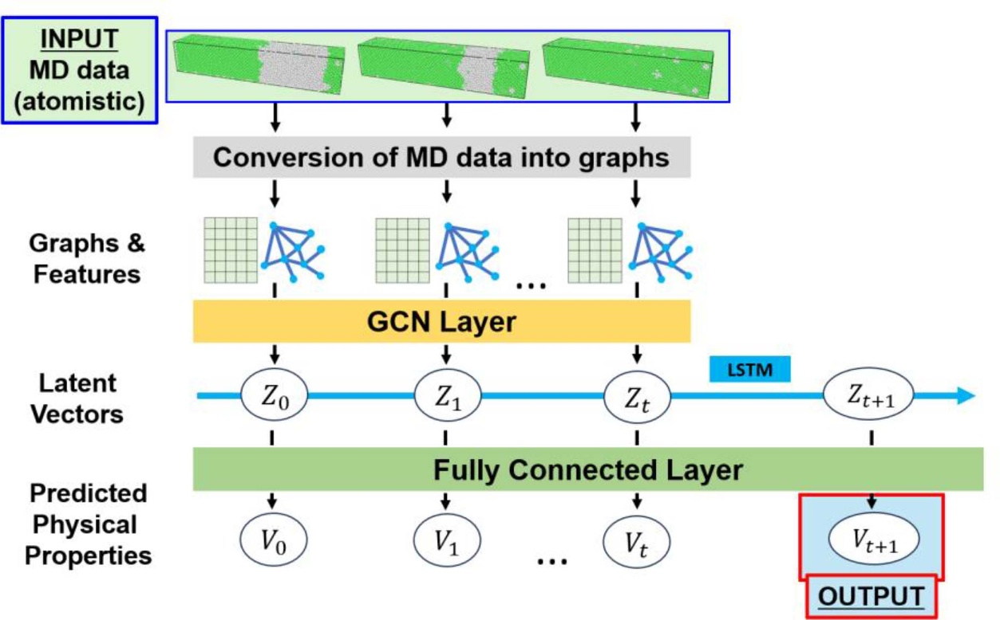
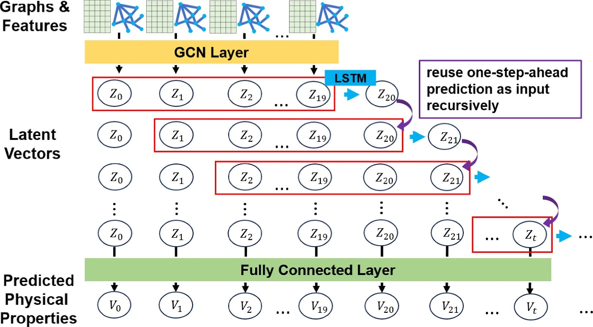
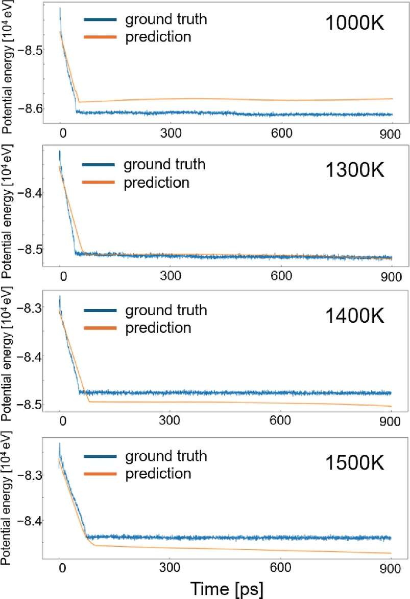

# MD-GNN TimeSeries

[](https://doi.org/10.1088/1361-648X/ad5821)
[](LICENSE)

Official implementation of **"Predicting long-term trends in physical properties from short-term molecular dynamics simulations using long short-term memory"** (Kota Noda and Yasushi Shibuta, *J. Phys.: Condens. Matter* **36** 385902, 2024, open access).

Given only the first 20 snapshots of an MD simulation, the model predicts how the potential energy evolves far beyond the simulated time. For a 900 ps prediction it runs about **700× faster** than the full MD simulation, and it captures the bend in the potential energy that marks the completion of solidification even though the input snapshots contain no such bend.

## How it works

The model extends [MD-GNN](https://github.com/nodematerial/MD-GNN) (our previous work) from a per-snapshot predictor into a time-series predictor.

<p align="center"></p>

1. **Graph representation** — Each atom in a snapshot becomes a node, and atoms closer than 2.7 Å are connected by an edge. Each node carries 9 features: position (x, y, z), velocity (vx, vy, vz), speed, number of edges, and the solid/liquid label from common neighbor analysis (CNA).
2. **GCN encoder** — Two GraphSAGE layers compress each snapshot (20,000 atoms) into a 32-dimensional latent vector.
3. **LSTM in latent space** — An LSTM takes 20 consecutive latent vectors and predicts the next one. A residual connection lets the model represent "no change", which stabilizes high-temperature and long-term predictions.
4. **Decoder** — A fully connected layer converts each latent vector back into the potential energy.

For long-term prediction, each predicted latent vector is fed back as input, so the trajectory is extended entirely in latent space without running MD.

<p align="center"></p>

## Results

The system is a Ni solid–liquid coexisting system (20,000 atoms) annealed at 1000–1900 K. Models are trained on 1000, 1200, 1400, 1600 and 1800 K and validated on 1100, 1300, 1500, 1700 and 1900 K.

| Task | Outcome |
|---|---|
| One-step-ahead prediction with residual connection | R² ≥ 0.96 on validation temperatures except 1700 K |
| Multi-step prediction from the first 20 snapshots | Captures solidification and its completion time up to 1500 K. Fails to capture melting at 1600 K and above |
| 900 ps prediction (1000–1500 K) | About 3.4 s versus about 2,300 s for MD |

<p align="center"></p>
<p align="center"><sub>900 ps prediction from the first 20 snapshots (orange) compared with MD (blue).</sub></p>

## Requirements

- NVIDIA GPU with CUDA support (the paper used an RTX A5000)
- Docker with [NVIDIA Container Toolkit](https://docs.nvidia.com/datacenter/cloud-native/container-toolkit/latest/install-guide.html)

The Docker image includes CUDA 13.4 on Ubuntu 26.04, Python 3.14, [LAMMPS](https://www.lammps.org/) built with the GPU and MANYBODY packages, and the latest PyTorch, PyTorch Geometric and OVITO. Python dependencies are installed with Poetry during the build.

LAMMPS is built for `sm_75` by default. For another GPU, pass its architecture, e.g. `docker compose build --build-arg GPU_ARCH=sm_86`.

The published results were obtained with Python 3.10, PyTorch 2.0.1 and CUDA 11.7. That environment is preserved at the [`paper`](https://github.com/nodematerial/MD-GNN_TimeSeries/tree/paper) tag.

```bash
git clone https://github.com/nodematerial/MD-GNN_TimeSeries.git
cd MD-GNN_TimeSeries
docker compose up -d --build
docker compose exec app bash
```

## Usage

### 1. Generate the dataset

Run the MD simulation and convert its output into graphs for each temperature. Each file in `configs/` corresponds to one temperature (`config1.yml` = 1000 K, …, `config10.yml` = 1900 K; `config_additional*.yml` = 1850–2100 K).

```bash
make all CONF_NAME=config1.yml
```

`make all` runs the following steps in order. Each step can also be run on its own.

| Command | What it does | Output |
|---|---|---|
| `make lmp` | Runs the LAMMPS simulation (90 ps, snapshot every 0.3 ps) | `dumpfiles/` |
| `make thermo` | Converts the LAMMPS log into CSV | `dataset/<dir>/thermo.csv` |
| `make cna` | Labels each atom as solid or liquid with CNA | `dataset/<dir>/cna/` |
| `make makegraph` | Builds node features and edges | `dataset/<dir>/2.7/` |
| `make remove` | Deletes the generated dump files and dataset for that config | — |

### 2. Train and evaluate

The experiments are organized by section number in the paper.

```bash
cd script/experiment
bash pipeline.sh
```

| Directory | Paper section | Content |
|---|---|---|
| `3-0` | — | Trains the GCN encoder (MD-GNN) |
| `3-1` | 3.1 | One-step-ahead prediction with LSTM |
| `3-2` | 3.2 | One-step-ahead prediction with residual connection |
| `3-3` | 3.3 | Multi-step prediction by recursive time evolution |
| `3-4` | 3.5 | 900 ps long-term prediction |

Hyperparameters are in each directory's `config.yml`. `script/supplemental_experiment` contains the additional high-temperature experiment (section 3.4).

## Repository structure

```
.
├── configs/                  # Per-temperature settings for dataset generation
├── lmpfile/Ni/               # LAMMPS inputs and the Ni EAM potential (Purja Pun & Mishin 2009)
├── script/
│   ├── makegraph.py          # Atom coordinates -> graph
│   ├── cna.py                # Common neighbor analysis
│   ├── log_process.py        # LAMMPS log -> CSV
│   ├── experiment/           # Main experiments (sections 3.1–3.3, 3.5)
│   └── supplemental_experiment/  # High-temperature experiment (section 3.4)
├── shell_script/             # Called by the makefile
├── Dockerfile
└── compose.yml
```

## Citation

```bibtex
@article{Noda2024,
  title   = {Predicting long-term trends in physical properties from short-term molecular dynamics simulations using long short-term memory},
  author  = {Noda, Kota and Shibuta, Yasushi},
  journal = {Journal of Physics: Condensed Matter},
  volume  = {36},
  number  = {38},
  pages   = {385902},
  year    = {2024},
  doi     = {10.1088/1361-648X/ad5821}
}
```

This work builds on our previous study:

```bibtex
@article{Noda2023,
  title   = {Prediction of potential energy profiles of molecular dynamic simulation by graph convolutional networks},
  author  = {Noda, Kota and Shibuta, Yasushi},
  journal = {Computational Materials Science},
  volume  = {229},
  pages   = {112448},
  year    = {2023},
  doi     = {10.1016/j.commatsci.2023.112448}
}
```

## License

The code is released under the [Apache License 2.0](LICENSE).

Figures are reproduced from Noda and Shibuta, *J. Phys.: Condens. Matter* **36** 385902 (2024), [CC BY 4.0](https://creativecommons.org/licenses/by/4.0/).
